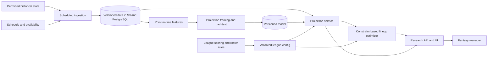

# FantasyEdge

**Development Status: In Progress**

Fantasy sports projections and lineup research. This repository currently contains design documentation only. The architecture and features below are proposed; no application implementation is claimed.

## Overview

A fantasy sports research platform that compares transparent player projections and lineup decisions with baselines.

## Problem

Fantasy decisions depend on changing player availability, schedule, and scoring rules. Opaque projections can hide data quality issues and encourage overconfidence.

## Proposed solution

Ingest permitted historical sports data, build reproducible player projections, and optimize lineups under explicit league constraints. Show uncertainty, source timestamps, and comparisons with simple baselines.

## Proposed tech stack

Python, pandas, scikit-learn, FastAPI, PostgreSQL, AWS S3, scheduled jobs, OR-Tools, Docker; licensed or public sports data subject to provider terms.

## Proposed architecture

The [architecture](architecture.md) explains the data flow and boundaries. The [technical design](technical-design.md) defines the first build and evaluation approach.

## Development roadmap

See the [phased development roadmap](development-roadmap.md). It describes planned work without implying that any phase is complete.
