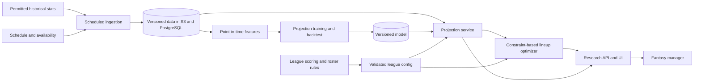

# FantasyEdge architecture

**Development Status: In Progress** — proposed design, not a deployed system.

## System diagram

## Data flow and boundaries

### Data and leakage control
Version raw data and use only information available before each game deadline. Track source timestamps and corrections. Exclude uncertain injury or lineup claims unless their source and update time are visible.

### Projection and optimization
Start with a historical average baseline and a regularized model. Predict fantasy points with uncertainty intervals. Optimize under salary, roster position, team, and budget constraints configured per league; reject infeasible lineups with an explanation.

### MVP boundary
Choose one sport, one league format, and one scoring system. No paid data or automated contest entry is required for the first version.

## Security and operating boundaries

Respect data-provider terms, store API keys outside the repository, make projections informational, and avoid automated paid-contest actions.

## Initial deployment approach

Build the smallest local or low-cost proof of concept first. Introduce managed cloud services only after the data contracts and baseline evaluation work locally. Record configuration, dataset versions, and costs so results can be reproduced.
